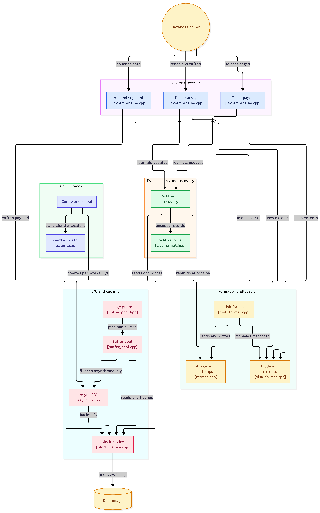
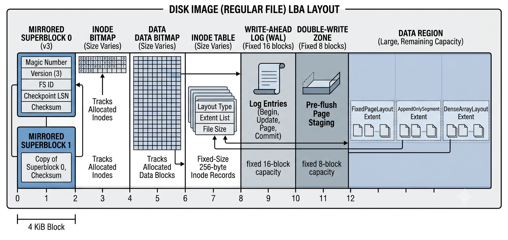

# Database-Oriented Filesystem

A Linux storage-layer prototype for database workloads. Instead of presenting a
general-purpose POSIX filesystem, it exposes fixed-size blocks, extents, and
database-oriented storage layouts directly to C++ callers.

The project explores how a filesystem can make storage behavior explicit:
allocation geometry, alignment, page updates, write ordering, and recovery are
part of the storage API rather than hidden behind ordinary files. It currently
operates on a regular file used as a disk image; it is **not** a kernel
filesystem and does not mount or implement POSIX paths and file operations.

## Why a database-oriented storage layer?

Databases commonly manage their own page caches and I/O policies. A conventional
filesystem can add another caching and allocation layer between the database
and storage, while its general-purpose file abstraction does not express
workload-specific needs such as fixed-size random updates, sequential segment
writes, or large aligned arrays.

This project instead provides a small set of explicit primitives:

- **4 KiB blocks** as the base on-disk and transactional unit.
- **Contiguous extents** for allocating storage regions.
- **Fixed-page, append-only, and dense-array layouts** for different access
  patterns.
- **Checksummed metadata and a write-ahead log (WAL)** for recoverable metadata
  and page updates.
- **An optional buffer pool and asynchronous I/O wrapper** for callers that
  want to manage caching and I/O explicitly.

These are building blocks for a database storage engine, not a replacement for
an established filesystem or database engine.

## Architecture Diagram





### Block device and asynchronous I/O

`fs::BlockDevice` opens or creates a regular-file image and provides bounded
offset-based reads and writes. The normal path requests `O_DIRECT | O_SYNC`;
buffers and lengths are adapted to the device's 4 KiB alignment requirements.
If direct I/O is unsupported for an operation, the implementation retries via
a non-direct descriptor. `flush()` calls `fsync`.

`fs::AsyncIo` wraps a liburing `io_uring` queue. It supports aligned read and
write requests, completion waiting, and request cleanup. `BlockDevice` also
provides synchronous wrapper methods for an asynchronous request; these submit
and wait for that individual operation. The buffer pool uses a background
flush thread and attempts `io_uring` for flushes, falling back to synchronous
device I/O if ring setup is unavailable.

### On-disk format and allocation

The current format is version 3 and uses 4 KiB blocks. Its main regions are:

| Region | Purpose |
| --- | --- |
| Blocks 0–1 | Mirrored, checksummed superblocks |
| Inode bitmap | Tracks allocated inodes |
| Data bitmap | Tracks allocated data-region blocks |
| Inode table | Fixed-size 256-byte inode records |
| WAL | Fixed-size transaction records and page images |
| Double-write zone | Stages page images before home-block writes |
| Data region | Allocated extents and payload blocks |



The WAL and double-write zone currently reserve 16 and 8 blocks, respectively.
The allocator finds contiguous free ranges in the data bitmap; inode extents
are stored inline with a single indirect extent-table block for additional
entries. The root inode and its initial directory data are created by
`format_image`.

### Workload-specific layouts

The layout API in `fs/layout_engine.hpp` currently contains:

- **`FixedPageLayout`** — preallocates one contiguous region for fixed-size
  pages. Page sizes must be multiples of 4 KiB. Page writes go through the
  WAL-backed transactional block-update path.
- **`AppendOnlySegment`** — preallocates a contiguous segment and appends
  non-empty 4 KiB multiples. Payload data is flushed before the inode size is
  updated, so recovery does not publish a size before the appended bytes are
  written.
- **`DenseArrayLayout`** — allocates a contiguous region whose start is aligned
  to 2 MiB and whose capacity is a non-zero 2 MiB multiple. Reads and writes
  use in-bounds 4 KiB multiples; writes use the WAL-backed page-update path.

These APIs expose inode numbers for reopening a layout. They do not currently
provide a directory lookup API or a complete file namespace.

### Buffer pool

`fs::BufferPool` is an in-memory cache of pinned 4 KiB blocks. Move-only
`PageGuard`s pin frames and can mark them dirty. The pool uses a 2Q-inspired
cold/hot replacement policy to resist one-pass scans and a background worker
to flush unpinned dirty pages. Call `flush_all()` when the caller needs to
wait for flush completion and receive reported I/O errors; the destructor
attempts a flush but cannot report errors.

This cache is a separate primitive. Its dirty-page writes are not automatically
wrapped in the filesystem WAL transaction API.

## Data path: database request to storage

For a fixed-size database page update, the current path is:

1. The caller creates or opens a `FixedPageLayout` and selects a page ID.
2. The layout maps that page to a byte offset in its contiguous extent.
3. The update path divides the byte range into 4 KiB filesystem blocks.
4. A transaction records a begin record, checksummed update headers, and
   complete page images in the WAL.
5. The WAL is flushed before a commit record is written and flushed.
6. For each updated block, the new page image is flushed to a double-write
   slot before the home block is written.
7. After the home-block writes are flushed, the checkpoint LSN is persisted
   to the mirrored superblocks and the WAL is cleared.

Transactions currently support up to seven distinct blocks: the fixed 16-block
WAL must fit a begin record, two records per update (header and page image),
and a commit record. The eight-block double-write zone imposes the same
seven-update practical limit in the current implementation.

## Crash recovery

Opening a filesystem with `CrashConsistency::open` marks the filesystem as
unclean and runs mount recovery. Recovery scans the WAL from its start, accepts
a complete committed transaction with valid checksums, and replays its page
images when its LSN is newer than the recorded checkpoint. A page is recovered
from its double-write slot when valid, or from its WAL page image otherwise.
Recovery then checkpoints the transaction, clears the WAL, and reconstructs
inode and data allocation bitmaps from valid inode extent references to reclaim
orphaned allocations.

`CrashConsistency::open_for_update` also marks the filesystem as unclean before
an update session proceeds. `shutdown()` flushes and writes the clean-shutdown
marker. A crash-recovery integration test kills a child process after a
committed multi-block WAL transaction and its double-write images have been
flushed, but before the home-block writes; reopening must replay both blocks
and preserve selected filesystem invariants.

**Recovery coverage is not exhaustive.** The test suite does not yet inject
crashes after every WAL record, during target writes, or during checkpointing.
The crash fixture stages on-disk records directly because the production commit
path has no failure-injection interface. This is useful recovery coverage, not
a power-loss qualification or a guarantee against every hardware failure mode.

## Concurrency model

`fs::CoreWorkerPool` is an experimental thread-per-core task executor:

- It discovers CPUs available to the process and pins one worker to each
  selected CPU using `pthread_setaffinity_np`.
- Each worker owns an `AsyncIo`/`io_uring` instance, a bounded task queue, and
  an in-memory `ExtentAllocator` covering a disjoint block-number shard.
- Producers dispatch tasks round-robin using an atomic counter. Task completion
  and exceptions are reported through `std::future<void>`.
- The task queues use atomic sequence numbers and compare-and-swap operations;
  dispatch does not use a central task mutex.

This pool does **not** make the persistent filesystem concurrent. Its worker
extent allocators are independent in-memory allocators, not shards of the
on-disk bitmap allocator, and the filesystem WAL manager is explicitly
single-writer. There is no integration that makes concurrent metadata updates
or WAL commits safe across workers. Queue saturation currently makes submitters
spin until a slot becomes available, and the present tests are functional
smoke coverage rather than a sustained-load or formal lock-free progress
verification. Treat this component as a prototype.

## Using the storage API

The library API is C++ and operates on an already formatted image. For example,
a storage engine can create a fixed-page region, update a page, and reopen the
region by its inode number:

```cpp
#include "fs/block_device.hpp"
#include "fs/disk_format.hpp"
#include "fs/layout_engine.hpp"

#include <vector>

auto device = fs::BlockDevice::open("database.img", fs::BlockDevice::Mode::ReadWrite);
const auto superblock = fs::read_superblock(device);

auto pages = fs::FixedPageLayout::create(device, superblock, 1024);
const uint64_t page_inode = pages.inode_number();

std::vector<std::byte> page(fs::kBlockSize, std::byte{0x2a});
pages.write_page(0, page);

auto reopened = fs::FixedPageLayout::open(device, superblock, page_inode);
reopened.read_page(0, page);
```

This illustrates the implemented C++ layout API. Applications are responsible for storing the inode number
and coordinating their own higher-level metadata and access policy.

## Build and run

### Requirements

- Linux with a C++20 compiler and CMake 3.20 or newer
- liburing development headers and library
- pthreads (provided by the system toolchain)

Configure and build:

```sh
cmake -S . -B build
cmake --build build -j
```

Create a 64 MiB filesystem image and inspect its metadata:

```sh
./build/filesystem-mkfs database.img 67108864
./build/filesystem-dumpfs database.img
```

The image size must be at least 128 KiB and a multiple of 4 KiB. Formatting
initializes the entire image; it is destructive to any existing contents at
the chosen path.

Run the registered tests:

```sh
ctest --test-dir build --output-on-failure
```

The current CTest suite covers aligned asynchronous I/O, extent allocation,
buffer-pool behavior, inode/extent metadata, storage layouts, WAL consistency,
the tested crash-recovery boundary, worker-pool behavior, and a bounded
database-style fixed-page workload. The eleven registered tests are marked
serial because several existing fixtures use the shared `/tmp/test.img` path.

### Database storage benchmark

Build and run the separate storage-layer benchmark:

```sh
cmake --build build --target database-benchmark
./build/database-benchmark [page-count] [operation-count] [random-seed] [image-directory] [repetitions]
```

The defaults are 4,096 pages (16 MiB of page data), 1,024 operations per
workload, seed `1592594996`, `/tmp` for temporary images, and five repetitions.
The benchmark creates unique custom-filesystem and POSIX baseline images in the
selected directory, reports the backing filesystem type, and removes its images
on exit. Select a directory on the filesystem you intend to evaluate; both
images are placed there. The sequential scan runs complete working-set passes
until it covers at least the requested operation count.

It measures sequential page writes, random page reads, random page updates,
sequential scans, and a mixed workload. Each repetition uses the same
deterministic operation plan for both backends, starts workloads from
reference-verified page contents, and verifies results before accepting the
measurements. Output includes each repetition and aggregate medians for
throughput and p50/p95/p99 call latency. Initialization, warm-up, reset, and
verification are excluded from timed intervals.

The baseline uses buffered POSIX `pread()`/`pwrite()`; reads can be served from
the OS page cache, and each timed write includes `fdatasync()`. The custom
filesystem uses `FixedPageLayout` and `BlockDevice`, with its WAL and
double-write commit path for page writes and direct I/O where supported.
These paths have different caching and durability semantics and are not a
perfectly equivalent comparison. POSIX runs first in each repetition, which
can introduce execution-order bias; repetitions also do not eliminate cache
state differences between buffered I/O and `O_DIRECT`. Results characterize
these storage paths only and do not predict SQLite or PostgreSQL performance.

`filesystem` is currently a bootstrap executable that directs users to the
separate `filesystem-mkfs` and `filesystem-dumpfs` tools; it is not a mounted
filesystem shell.

## Tests

Build and run all registered tests with:

```sh
cmake --build build -j
ctest --test-dir build --output-on-failure
```

CTest registers eleven executables:

| Test | Additional behavior checked |
| --- | --- |
| `test-async-io` | Aligned liburing read/write round trip |
| `test-extent` | Empty/oversized allocation, contiguous reuse, fragmentation, overflow-safe bounds, and atomic rejection of partial/double release |
| `test-buffer-pool` | 2Q scan resistance, dirty flush persistence, pinned-frame exhaustion, and frame reuse after unpin |
| `test-metadata` | WAL-backed extent allocation/release and indirect extent-table persistence |
| `test-layout` | Layout create/open/read/write paths plus invalid geometry, page IDs, sizes, and capacity bounds |
| `test-crash-consistency` | Multi-block WAL transaction, double-write staging, orphan reclamation, idempotence, and mirrored superblock fallback |
| `test-crash-recovery` | Child-process termination after committed WAL and double-write staging, followed by replay and invariant checks |
| `test-core-worker-pool` | Four concurrent producers submitting 1,024 tasks, worker affinity/shards, simultaneous execution, task exception propagation, and queued-task draining at destruction |
| `test-block-device` | Partial and aligned I/O, close/reopen persistence, bounds rejection, and read-only write rejection |
| `test-wal-recovery-edges` | Ignore incomplete transactions and reject committed transactions whose WAL and double-write page images both fail checksum validation |
| `test-database-workload` | Deterministic sequential and random fixed-page writes/reads, overwrite validation, invalid-input rejection, and persistence after reopening |

These are functional tests, not benchmarks or exhaustive stress/fault-injection
tests. In particular, the worker-pool test exercises concurrent submission and
task execution at a bounded workload; it does not prove formal lock-free
progress or production behavior under sustained load. WAL crash injection still
covers only selected recovery boundaries.
